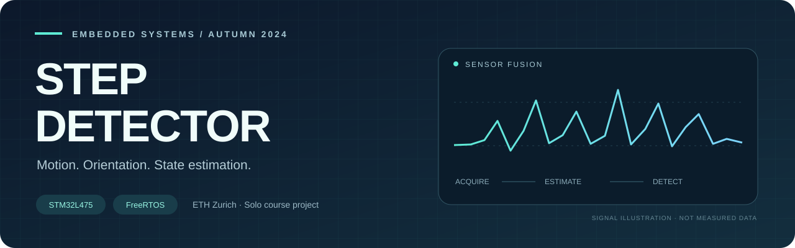
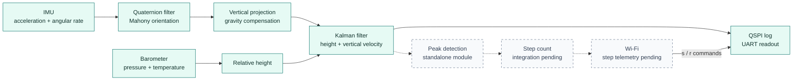

<div align="center">



**From inertial measurements to a step-detection pipeline.**


[Pipeline](#signal-pipeline) · [Inside the Kalman filter](#inside-the-kalman-filter) · [Build & flash](#build--flash) · [Code & credits](#code--credits)

</div>

## The project

Step Detector is my solo project for the ETH Zurich P&S course **“Microcontrollers for Sensors and the Internet of Things”**, completed in autumn 2024. It brings together embedded C, FreeRTOS, sensor acquisition, quaternion orientation estimation, a Kalman filter, flash logging and Wi-Fi on an STM32 IoT Discovery node.

The core contribution is my **two-state Kalman implementation**, carried over from my own earlier **VariometerV2** project. It combines barometric height with orientation-compensated acceleration to estimate vertical motion. The repository also contains a streaming peak detector for the step-counting stage. Matrix/Cholesky routines were copied from external code, and parts of the quaternion filter were adapted from an Arduino library; those are credited separately below.

> **Snapshot status:** this checkout runs the sensor-fusion, recording and Wi-Fi control paths. The peak detector is a standalone module; it is not yet called by the running tasks. Wi-Fi currently receives recording commands and sends a fixed reply, rather than a step count. The diagram distinguishes that remaining integration work. No measured accuracy is claimed.

## Hardware

| Part | Role in this project |
| :--- | :--- |
| **B-L475E-IOT01A1** STM32 IoT Discovery node | Board selected in the CubeIDE project |
| **STM32L475VGT6** / Cortex-M4 | Runs the C firmware and FreeRTOS tasks |
| **LSM6DSL** accelerometer + gyroscope | Inertial measurements over I²C2; configured for ±2 g, ±2000 °/s and a 104 Hz sensor output data rate |
| **LPS22HB** pressure + temperature sensor | Relative barometric height and initial temperature reference over I²C2 |
| **ISM43362 / Inventek eS-WiFi** module | Wi-Fi connection and TCP control over SPI3 |
| **MX25R6435F** external QSPI flash | Stores measurement records for later readout |
| Onboard **ST-LINK** and USART1 | Programming/debugging and serial output at 115200 baud, 8-N-1 |

The active orientation update uses accelerometer and gyroscope inputs. Although the IMU driver is also asked for magnetometer data, the running Mahony call does not consume it.

## Signal pipeline



**Solid paths** are connected in this snapshot. **Dotted paths** show the intended step-counting and telemetry integration. The Wi-Fi command channel is already implemented.

The IMU task projects acceleration onto the estimated vertical axis. The fusion task averages queued samples, subtracts gravity and combines the result with relative barometric height. The peak detector alternates between maxima and minima, confirming an extremum after the signal moves away by a configurable `delta`. Its output arrays retain sample indices; the application still needs to select a signal and turn those events into a step count.

## FreeRTOS task structure

Tasks are created in [`Core/Src/main.c`](Core/Src/main.c), using the CMSIS-RTOS v1 wrapper alongside native FreeRTOS queues and a mutex.

| Task / entry point | Responsibility | Timing / communication |
| :--- | :--- | :--- |
| `measureTask` | Configure/read the LSM6DSL, update orientation, project acceleration | `vTaskDelay(1)` between iterations; writes to `accQueue` (10 floats) |
| `KalmanTask` / `presKalmanTask` | Read pressure, establish a reference, fuse acceleration and height | 40 ms delay per loop plus work; drains `accQueue`, writes to `measureQueue` (5 records) |
| `flashSaveTask` / `saveTask` | Pack records into 256-byte pages and write QSPI flash | Waits for records from `measureQueue`; erases 4 KiB sectors as needed |
| `flashReadTask` / `readTask` | Read marked records from flash and print CSV-style UART lines | Activated by the read state; deletes itself after readout |
| `wifiTask` / `wifiServerTask` | Join Wi-Fi, open a TCP client connection, receive commands | First byte `s`: start saving; `r`: start reading; sends a fixed greeting reply |
| `defaultTask` / `StartDefaultTask` | CubeMX default thread | Sleeps with `osDelay(1)` |

An I²C mutex serializes access to the shared bus. The IMU task creates that mutex and its queue; the fusion task creates the recording queue. All listed tasks use normal priority. Sampling-loop delays are implementation settings, not measured end-to-end rates.

The session state starts at `isWaiting` and permits one transition to `isSaving` or `isReading`. To read a recording after saving, reset the board and send `r` in the new session. The reader prints measurements over **UART**, not over TCP.

## Inside the Kalman filter

The filter lives in [`kalman.c`](Core/Src/Kalman/kalman.c) and [`kalman.h`](Core/Inc/Kalman/kalman.h); the application model and noise settings are in `ResetKalman()` and `presKalmanTask()` in [`tasks.c`](Core/Src/tasks.c).

### State and model

The state contains **relative height** and **vertical velocity**. Gravity-compensated acceleration is the control input; barometric height is the observation:

$$
x = \begin{bmatrix}h\\v\end{bmatrix},\qquad
u = a_{\mathrm{vertical}} - g,\qquad z = h_{\mathrm{barometer}}
$$

$$
F = \begin{bmatrix}1 & \Delta t\\0 & 1\end{bmatrix},\qquad
G = \begin{bmatrix}\tfrac{1}{2}\Delta t^2\\\Delta t\end{bmatrix},\qquad
H = \begin{bmatrix}1 & 0\end{bmatrix}
$$

$$
Q = \sigma_a^2
\begin{bmatrix}
\tfrac{1}{4}\Delta t^4 & \tfrac{1}{2}\Delta t^3\\
\tfrac{1}{2}\Delta t^3 & \Delta t^2
\end{bmatrix},\qquad
R = \begin{bmatrix}\sigma_h^2\end{bmatrix}
$$

The code recomputes `F`, `G` and `Q` from elapsed HAL ticks. `P` starts as `diag(500, 500)`. The values `sigma_a = 0.2` and `sigma_h = 0.1298` are the source's noise parameters, not reported accuracy measurements.

### Prediction, correction and storage

`kalman_predict()` evaluates `x = Fx + Gu` and `P = FPFᵀ + Q`. `kalman_update()` forms the innovation `z − Hx` and innovation covariance `S = HPHᵀ + R`, computes the gain, and corrects the state. Covariance uses the **Joseph form**:

$$
P = (I-KH)P(I-KH)^T + KRK^T
$$

The numerical support uses an in-place **Cholesky factorization** of `S` and triangular solves to form its inverse. The current model has a scalar observation, so `S` is 1 × 1. These support routines are external code, not my original implementation.

Matrices use `float` elements and row-major storage. `kalman_t` owns fixed-size arrays for states, matrices and scratch space; the numerical routines do not allocate heap memory. FreeRTOS tasks, queues and the mutex are dynamically created separately.

The task makes an initial prediction, then performs correction followed by prediction on each iteration. Logged height/velocity values are taken after that prediction.

<details>
<summary><strong>Implementation notes and remaining work</strong></summary>

- Connect the peak detector to a chosen signal, define the step-count rule and publish that count over Wi-Fi.
- The legacy `kalmanVertAcc` logging field reads row 2 of a two-element state vector. That is out of bounds and must not be treated as a valid acceleration estimate. Height and velocity are the defined states.
- Cholesky reports failure for non-positive pivots, but `kalman_update()` currently does not handle its return status.
- Task startup relies on the IMU task creating the I²C mutex before the fusion task uses it; explicit initialization before starting the scheduler would make that dependency clearer.
- Queue sends can fail when full. The acquisition loop polls faster than the configured sensor output data rate and can read repeated samples.
- Wi-Fi connection/reconnection behavior and the finite peak buffers need further work for a continuous application.

These observations describe the archived course implementation; they are not validation results from a new hardware run.

</details>

## Build & flash

### 1. Import the project

Install **STM32CubeIDE** with its STM32 Arm GCC toolchain and ST-LINK support. Import the repository with **File → Import → General → Existing Projects into Workspace**, selecting the repository root and the `Step_Detector` project.

The repository retains `.project`, `.cproject`, `.mxproject`, the linker scripts and [`Step_Detector.ioc`](Step_Detector.ioc). The saved configuration records **CubeMX 6.12.1** and **STM32Cube FW_L4 V1.18.1**; the removed machine-specific launch file referenced CubeIDE 1.16.1. Vendor source is included. Import the existing project first; regeneration is optional and should be reviewed for changes to custom code.

### 2. Configure your network

From the repository root:

```sh
cp Core/Inc/WiFi/wifi_config.example.h Core/Inc/WiFi/wifi_config.local.h
```

Edit the local header with your Wi-Fi SSID/password and the IPv4 address/port of a TCP server on your network. The example address is for documentation only. The local header is ignored by Git and is required by `wifi_task.c`; do not force-add it. `es_wifi_conf.h` configures the driver and is not the place for your credentials.

### 3. Build and program

1. Select the **Debug** build configuration and choose **Project → Build Project**.
2. Connect the board's **ST-LINK USB** connector with a data-capable cable.
3. Select **Debug As → STM32 C/C++ Application**, choose ST-LINK/SWD, and let CubeIDE create a local launch configuration. Resume execution after programming.
4. Open the board's serial connection at **115200 baud, 8 data bits, no parity, 1 stop bit** to see startup and recording output.

An Arm toolchain, CubeIDE and the physical board are required to verify the complete build/flash/runtime path. This publication preparation did not include a new board test.

### 4. Control recording over TCP

Start a TCP listener on the configured receiver before the board connects. For example, using Python on that machine:

```sh
python3 - <<'PY'
import socket

with socket.socket() as server:
    server.setsockopt(socket.SOL_SOCKET, socket.SO_REUSEADDR, 1)
    server.bind(("0.0.0.0", 8080))  # Match STEP_WIFI_REMOTE_PORT.
    server.listen(1)
    connection, address = server.accept()
    with connection:
        print("Board connected:", address)
        command = input("s = record, r = read existing recording: ").strip()
        if command not in {"s", "r"}:
            raise SystemExit("Choose s or r")
        connection.sendall(command.encode("ascii"))
        print(connection.recv(500).decode("ascii", errors="replace"))
        input("Press Enter to close the connection. ")
PY
```

For readout, capture UART output to a local file. `printData()` emits six comma-separated fields: `acc`, `diffHeight`, `kalmanHeight`, `kalmanVertVel`, legacy `kalmanVertAcc`, and `time` in milliseconds. `acc` is already vertical-projected and gravity-compensated; it is not the raw three-axis IMU vector. Discard the invalid legacy acceleration field described above.

No captured sensor dataset was found in the repository history. There is therefore no measured signal plot or accuracy benchmark included.

## Code & credits

### My original estimator

| Exact files | Contribution |
| :--- | :--- |
| [`Core/Src/Kalman/kalman.c`](Core/Src/Kalman/kalman.c), [`Core/Inc/Kalman/kalman.h`](Core/Inc/Kalman/kalman.h) | My Kalman implementation, originally written for my VariometerV2 project and reused here |

### Project application and integration

I wrote the following application modules and the custom integration in `main.c`. They are separate from the vendor drivers and generated setup code.

| Exact files | Role |
| :--- | :--- |
| [`Core/Src/tasks.c`](Core/Src/tasks.c), [`Core/Inc/tasks.h`](Core/Inc/tasks.h) | Sensor acquisition, vertical-motion model, task coordination, flash recording/readout |
| [`Core/Src/peakDetection.c`](Core/Src/peakDetection.c), [`Core/Inc/peakDetection.h`](Core/Inc/peakDetection.h) | Streaming extrema detector; not yet wired into a task |
| [`Core/Src/WiFi/wifi_task.c`](Core/Src/WiFi/wifi_task.c), [`Core/Inc/WiFi/wifi_task.h`](Core/Inc/WiFi/wifi_task.h) | Wi-Fi/TCP application task and recording commands |
| [`Core/Src/main.c`](Core/Src/main.c), `USER CODE` sections only | Task creation, UART redirection and Wi-Fi interrupt integration within generated ST scaffolding |
| [`Core/Inc/WiFi/wifi_config.example.h`](Core/Inc/WiFi/wifi_config.example.h) | Public configuration example added during publication preparation |

### External code and generated scaffolding

| Exact paths | Origin |
| :--- | :--- |
| `Core/Src/Kalman/matrix.c`, `Core/Inc/Kalman/matrix.h`, `Core/Src/Kalman/cholesky.c`, `Core/Inc/Kalman/cholesky.h`, `Core/Inc/Kalman/compiler.h` | Copied/adapted numerical support matching `sunsided/kalman-clib`; MIT and existing EJML credits retained |
| `Core/Src/QuaternionFilter.c`, `Core/Inc/QuaternionFilter.h` | Contains adapted Arduino orientation-filter code, including Mahony/Madgwick routines; original library/version no longer known |
| `Drivers/**` | STM32 HAL and ARM/CMSIS support |
| `Middlewares/Third_Party/FreeRTOS/**` | FreeRTOS kernel, Cortex-M4F port, allocator and CMSIS-RTOS wrapper |
| `Core/{Inc,Src}/lsm6dsl_reg.{h,c}`, `Core/{Inc,Src}/lps22hb.{h,c}` | ST sensor drivers, with project adaptations where present |
| `Core/Inc/mx25r6435f.h`, `Core/Inc/stm32l475e_iot01_qspi.h`, `Core/Src/stm32l475e_iot01_qspi.c` | ST component/BSP support for external flash |
| `Core/Inc/WiFi/es_wifi.h`, `es_wifi_io.h`, `es_wifi_conf.h`, `es_wifi_conf_template.h`, `wifi.h`; `Core/Src/WiFi/es_wifi.c`, `es_wifi_io.c`, `wifi.c` | ST/Inventek eS-WiFi driver, transport and wrapper |
| `Core/Src/main.c` outside project additions; `freertos.c`, `stm32l4xx_hal_msp.c`, `stm32l4xx_hal_timebase_tim.c`, `stm32l4xx_it.c`, `system_stm32l4xx.c`, `syscalls.c`, `sysmem.c`; corresponding configuration headers, `Core/Startup/**`, `*.ld` | CubeMX/CubeIDE generated scaffolding |

[`.gitattributes`](.gitattributes) excludes vendor/generated code from the project's language statistics. Original copyright headers and bundled licenses are preserved. See [`THIRD_PARTY.md`](THIRD_PARTY.md) for license scope and unresolved provenance.

## Course context & license

Developed independently in autumn 2024 for the ETH Zurich P&S course **“Microcontrollers for Sensors and the Internet of Things.”** This is a personal course-project repository, not an official ETH distribution.

My original code is offered under the **[MIT License](LICENSE)**. That grant does not relicense copied libraries, ST-generated code, vendor drivers, FreeRTOS or any course templates. Their own notices and terms apply. The original Arduino library/version for the orientation code is no longer known and its license is not asserted here; see [third-party notes](THIRD_PARTY.md) and the [publication notes](docs/PUBLISHING.md).
